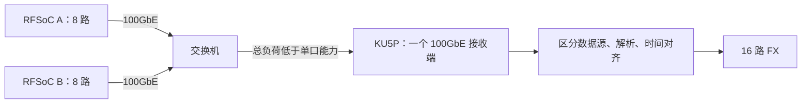

# 两台 RFSoC、16 路输入：接入方案与下一步

日期：2026-10-27。阶段：资料核对与规划，未运行新的硬件构建或上板测试。

后续更新：用户已要求开始数据处理实现，并进一步明确近期先做 FX，以通用可见度输出和校准基础为主，FFTT 保留为长期目标。最新主线见 [实施与学习路线](implementation-roadmap.md)，第一课已完成行为仿真和独立综合；本文的网络与十六路 136 项 FX 容量预算继续作为近期目标依据。

用户已确认这里的“两路输入”是两台 RFSoC 各发送八路数据，合计十六路信号流。先前八路记录作为历史基线保留；每路有效科学带宽 100 MHz 的要求不自动降低，具体十六路天线/极化映射待明确。

## 1. 对双路 81.92 Gb/s 的判断

目前不能把这张 KU5P 卡按“两路 100GbE 接收已经可用”来规划。

厂家原理图 Rev1.0 的第六个 PDF 页显示：QSFP0、QSFP1 各接一组四通道 GTY，分别为 Bank 227、226，PCIe 使用 Bank 224/225。这支持继续调查两个高速连接器，不能单独证明两套 Ethernet 接收通路已经实现。厂家手册的 25.78125 Gb/s IBERT 记录也不能代替双口 Ethernet 吞吐证据。

KU5P 只有一个硬化 100G Ethernet 模块，见 [AMD XMP103 的 Kintex UltraScale+ 资源表](https://docs.amd.com/api/khub/documents/Fz8MLna3N2KIo_xWN_Iv3w/content)。现有硬核不能直接充当两个独立的 100GbE 接收端。若要双口同时直收，必须另有经过验证的第二套 MAC/PCS 等实现，评估资源、授权、GT、时钟、FEC 及剩余计算容量；尚无本卡这种配置的证据。不能由一个硬核推导“一切双口方案都不可能”，也不能由两个连接器推导“原生双 100G 已经可用”。

两台 320 MS/s、I/Q 各 16 位的净输入合计 163.84 Gb/s，不能持续汇聚到一个 100GbE 接收口。即使未来补齐双口接收，仍要另外证明十六路 FX 的计算与存储可以闭合。

精确器件仍要以实物和厂家源工程核实。原理图为 FFVB676，而仓库早期示例为 FFVA676；[AMD DS922](https://docs.amd.com/r/en-US/ds922-kintex-ultrascale-plus/GTY-Transceiver-Switching-Characteristics) 列明部分封装包括 FFVA676 的 GTY 线速受限，不能沿用示例 part 来证明 25G-lane 的能力。CMAC 还有限定的 GT 放置规则，见 [PG203](https://docs.amd.com/r/en-US/pg203-cmac-usplus/Transceiver-Selection-Rules)。

## 2. 100 MS/s 版本已核实存在

已在用户下载目录的 `sync_daq_100MSps_iq_20261026_2053.tar.gz` 中读取九个关键文件，仅将这些文件提取到仓库外的本地研究目录，没有展开或复制整份工程进 KU5P 仓库。

| 配置 | 100 MS/s 工程 | 320 MS/s 工程 |
|---|---|---|
| 器件/工具 | XCZU47DR，2025.2 | XCZU47DR，2025.2 |
| 每板输入 | 8 路复数 | 8 路复数 |
| ADC 采样率 | 4 GS/s | 3.84 GS/s |
| RFDC 抽取 | 40 | 12 |
| 每路输出采样率 | 100 MS/s | 320 MS/s |
| I/Q 容器 | 各 16 位 | 各 16 位 |
| PL 每拍复数样本数 | 1，100 MHz | 2，160 MHz |
| 网络出口 | CMAC 100GbE | CMAC 100GbE |
| MTS 目标延迟配置 | 320 | 240 |

软件配置、RFDC 参数与合并器实例三处相符。两版的元数据定义文件与控制消息头文件分别相同；打包器状态机和长度也经静态核对相符。但实现文件并非全都相同，不能仅换软件中的采样率上报值来完成版本切换。

以上是工程配置证据，现场板卡运行版本、实际时钟及数据还需核验。

## 3. 输入带宽比较

下表按每板八路、两板十六路、I/Q 各 16 位计算。100 与 320 是已查看的工程配置；125 与 160 仅为后续候选预算，没有相应新工程或测试证据。

| 每路复数采样率 | 每板净输入 | 两板净输入 | 汇聚到单个 100GbE 的带宽初筛 |
|---|---:|---:|---|
| 100 MS/s | 25.60 Gb/s | 51.20 Gb/s | 净带宽有余量，值得优先验证 |
| 125 MS/s（候选） | 32.00 Gb/s | 64.00 Gb/s | 净带宽有余量，需完整配置/通带证据 |
| 160 MS/s（候选） | 40.96 Gb/s | 81.92 Gb/s | 净带宽可能容纳，余量与拥塞需验证 |
| 320 MS/s | 81.92 Gb/s | 163.84 Gb/s | 无法持续全量汇聚 |

若沿用当前每包 8192 字节采样、8320 字节 Ethernet AXI 数据，再计 4 字节 FCS、8 字节前导/SFD 与平均 12 字节 IFG、无 VLAN，两板 100 MS/s 约占 52.15 Gb/s，320 MS/s 约占 166.88 Gb/s。这是算式估计，不是持续吞吐或交换机性能实测。

降低采样率不改变 Ethernet 物理链路的速率：100 MS/s 版仍发 100GbE。它不能直接接到一个 25GbE 接收端；而且每板净载荷 25.6 Gb/s 已超过单条 25GbE 的速率。

## 4. 值得先验证的连接路线

在有合适交换机和 KU5P 单口 100G 工程的条件下，优先评估两台低负荷数据源经交换机汇聚到 KU5P 一个 100GbE 接收口：

这是网络/算法结构候选，尚未定案或要求购置设备。需核对现有交换机端口、MTU、缓存、转发与流控、源端突发以及 FEC/模块兼容。平均负荷低于 100 Gb/s 不能替代拥塞与持续不丢包验证。没有该网络条件时，可先做单板八路通路与离线十六路验证，继续比较其他接入方案。

如果坚持两台 320 MS/s 全量输入，则另行比较真正的双 100G 接收实现、上游先带限降速/降位/频道化、或跨多张卡分工。两张卡各处理八路不能自动给出跨板相关结果，需要补充数据交换或集中 X 的设计；尚不选择或购买新硬件。

## 5. 100 MS/s 不等于已满足 100 MHz 有效带宽

复数采样率决定频谱覆盖的格点范围，实际可用通带还受 RFDC 抽取滤波与科学误差阈值限制。[PG269 RF-ADC Features](https://docs.amd.com/r/en-US/pg269-rf-data-converter/RF-ADC-Features) 说明其抽取滤波采用 80% Nyquist 通带指标；[Gen3/DFE 滤波细节](https://docs.amd.com/r/en-US/pg269-rf-data-converter/Decimation-Filter-Details-Gen-3/DFE) 给出系数与响应。

因此，100 MS/s 版适合作为低负荷链路/算法联调基线，不能直接批准为“完整 100 MHz 平坦有效通带”的最终科学模式。接下来先核对本配置的级联滤波响应，明确通带、过渡带与允许误差。若需更高输出采样率，可评估 125/160 MS/s 等方案，但要重新设计并验证时钟、抽取、AXI 样本数和同步。125/160 是候选，不是已提供版本。

## 6. 十六路计算与同步预算

若目标是完整十六路相关，独立结果数为 `16*17/2=136`，包含十六个自相关和一百二十个互相关。两套八路相关器仅得到 72 项独立结果，会缺少 64 项跨 RFSoC 的相关乘积。

| 预算项 | 原八路 | 当前十六路 |
|---|---:|---:|
| 独立相关数 | 36 | 136 |
| 100 MS/s、全频道 X 更新率 | 3.6 G 次/秒 | 13.6 G 次/秒 |
| 320 MS/s、全频道 X 更新率 | 11.52 G 次/秒 | 43.52 G 次/秒 |
| 512 点、实虚各 64 位、完整复数双缓冲 | 0.5625 MiB | 2.125 MiB |
| 4096 点、同一存储方案 | 4.5 MiB | 17 MiB |

存储值是理想有效位容量，不含权重、映射损失、F/网络/重排缓存；64 位是预算候选，不是最终位宽。KU5P BRAM+URAM 原始容量约 4.36 MiB，不能采用 4096 点的朴素十六路双缓冲方案。首版继续固定 512 点，评估位宽和调度后再演进。若只保留 K 个有效科学频道，应按 `136*K*f_s/N` 计算 X 负荷，不能照搬全频道数，也不能据此消除 F 和接收负荷。

两台设备都使用 port_id 0–7；接收器必须先依据可验证的网络源/路由配置区分 `source_id`，再映射为全局流编号，不能只看 port_id。共同时间契约须包括参考时钟、PPS、NCO 复位/配置生效、采集会话及首样本对应关系。两个板的相同包号不自动表示相同采样时刻；交换机到达时间也不提供这种保证。

## 7. 接下来的具体顺序

1. **先完成输入与科学通带规格**：把已核实的 100/320 配置、全局十六路编号、会话/配置记录、缺样规则及滤波通带列成可核验契约。退出证据是已知字节和样本编号能够明确解释，科学目标没有因选低速版本而静默改变。
2. **建立离线协议/数值验证基础并细化资源预算**：规划独立解析器、可重放计数/单音/已知相位数据、两路 512 点参考结果；按十六路 136 项推导位宽、缓存访问与吞吐。退出证据是解析和数学检查可独立复核，并有余量可信的实现方案。当前仍处于规划，尚未执行新的代码实现。
3. **验证单板到 KU5P 的最小接收通路**：先依厂家可重建工程核对精确器件、GT/时钟和单口 100G，使用低负荷版本检查逐样本连续性、包数和源状态。上板前先明确现场操作与恢复条件。
4. **再增加第二台并验证跨板相干**：按选定接入路线验证十六路映射、拥塞、共同起点、重启重复性和跨板已知相位；同一短记录对照参考模型。吞吐足够与相位正确分别验收。
5. **逐步结合 F/X 并扩展**：先两路、固定 512、M 可配和约 1 s 积分，再扩展十六路与全部规定科学频段；更长 FFT、短积分和更高速配置逐项验证。

本轮完成了 100 MS/s 资料抽查、双源带宽/产品数/理想存储推导和方案排序。未运行原工程脚本、编译或板卡操作；原始 RFSoC 工程文件保持仓库外，未推送 GitHub。
