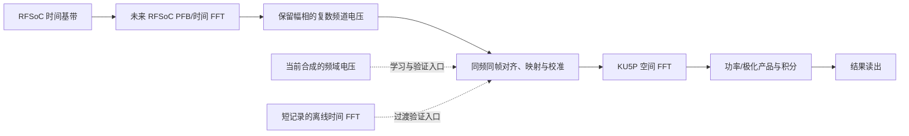

# 实施与学习路线：先做 FX，FFTT 保留为长期目标

2026-10-31本轮开发已执行：e6已通过离线SIM/ROUTED接受，尚未上板。 详见[H1a实施](lesson05j-pcie-reference-reset.md)。e5拒绝/失败证据保留，e6更改PHY复位控制合同；本轮未做BOARD、驱动、100G或FX扩展。下方只读/未实施文字继续作为历史，不覆盖本轮结果。

2026-10-31最新计划覆盖：M0及两次保留配置重启已有独立记录；目前优先板卡PCIe，H1仍无L0。下一项建议H1a-CFG离线参数传播/完整lane映射、观察验收和官方最小端点对照，见[具体合同](pcie-audit-and-next-plan-2026-10-31.md)。本轮仅审计规划，无实施授权升级。下方旧暂停/网卡装不上/待M0描述均属历史；网卡已装第一槽，光链尚未测。

用户最新安排：最后一次尝试结束后暂停开发。e4独立记录器已通过实现、时序/CDC和实板观察链验收，但PLL/GT没有稳定初始化、未建链/枚举；当前e4/reset0，见[最后实测与停止点](lesson05i-pcie-boot-recorder.md)。不自动继续任何构建、FX任务、时钟修改或主机重启；下面路线供用户以后要求继续时参考。

更新：2026-10-29。近期先实现 FX 相关器，以获得更通用的复数可见度输出，并为未来校准与 FFTT 留下基础。已完成单路功率、两通道 X、双 512 点时间 FFT-FX，以及第四课的 PFB/计划窗口/有效贡献与帧标签；第三、四课采用可暂停的分帧回放。RFSoC 原始工程继续只在本地保存，不上传 GitHub。当前硬件阻塞与后续顺序见[问题复盘与恢复路线](review-and-recovery-plan-2026-10-29.md)。

已完成 [Vivado MCP 辅助工具](vivado-mcp.md) 接入并恢复 FPGA 主线。第四课完成 PFB-FX；第五课 A 进一步完成片内回放、板级时序和两次真实 FPGA 抓取验收。用户暂不便连接 RFSoC，但已有尚未安装的 ConnectX-5、两只 SR4 模块及 OM3-MPO 跳线，因此先完成离线协议、PC↔KU5P 链路准备和连续处理，真实采集接入不作为这些开发的前置条件，详见[接入前准备](rfsoc-preparation.md)。

## 1. 近期先实现 FX

F 对各天线时域样本做频道化，X 对同频、同时间帧的两路复数电压做共轭乘积与积分，输出复数相关结果以及权重、时间与配置记录。最小闭环先固定 512 点时间 FFT，随后加入并验证 PFB。当前两份 RFSoC 工程仍输出时域基带，不能假设上游已完成 F。

`RFSoC 时域 I/Q → 解析与对齐 → PFB/时间 FFT（F）→ 共轭乘积与积分（X）→ 复数可见度`

为了先隔离问题，第二课从合成的同频、同帧电压验证 X，第三课用合成时域数据接通 FPGA 内的两个 512 点 FFT 与逐频道 X。第四课增加 4 抽头/相位的 PFB，窗口按计划帧号结束，并记录 W_A/W_B/W_AB。学习结构可参考 [CASPER 相关器教程](https://casper-toolflow.readthedocs.io/projects/tutorials/en/latest/tutorials/roach/tut_corr.html)，但不直接采用旧平台的位宽或设计文件。

## 2. 长期目标按 FFTT 记录

用户的长期方向是：RFSoC 输出各天线的频道化复数电压，KU5P 对同一频率、同一采样时刻的天线数据做空间傅里叶变换，并形成功率/极化产品与时间积分，建立十六通道 FFTT demo。该方向留在近期 FX 之后，不安排为下一课。

时间 FFT 和空间 FFT 是两个不同维度的操作：

- 时间 FFT/PFB：对同一天线的一段时间样本进行频道化，得到 `E_a[k,m]`。`a` 是天线/信号流，`k` 是频率频道，`m` 是频谱帧。
- 空间 FFT：固定 `k,m`，按天线位置排列 `E_a`，经幅相校准与加权后，变换为不同方向的复数波束电压 `B_b[k,m]`。
- 检波与积分：对空间变换后的 `B` 计算 `|B|²` 并在已定义时间窗口积分。双极化需要分别处理相应电压及后续极化乘积。

当前提供的 100/320 MS/s RFSoC 工程输出时域复数基带，尚未证明已经提供未来的频道化接口。学习与空间算法开发可先用合成频域电压或短记录的离线时间 FFT，不必等待上游改完。

空间 FFT 的输入必须保留复数电压。逐天线先变成功率谱，会丢掉空间合成所需的相对相位；本课功率模块的长期位置在空间 FFT 之后，或作为独立诊断分支。

规则矩形阵列是 FFTT 的一种适用布局，参考 [Tegmark 与 Zaldarriaga 的 FFT Telescope 论文](https://arxiv.org/abs/0805.4414)。天线幅相校准是空间合成前的重要条件，参考 [规则阵列的 FFT 相关器标定研究](https://academic.oup.com/mnras/article/500/1/66/5935245)。

## 3. 十六通道 FFTT 的长期演示边界

算法演示可以暂以单极化、十六个位置、4×4 等间距阵列为候选。它只是可复现的合成数据几何，不能把真实天线任意编号后直接当作规则空间格点。

需要以后核对的内容包括真实坐标、阵元间距与波长、视场与栅瓣、阵元响应、线缆/采样延迟、频率和边带符号、极化映射、跨板共同时间与幅相校准。空间 FFT 的索引也不能不经这些定义就直接标成天空角度。

如果十六个电压通道实际来自八副双极化天线，应按每个极化的八个位置处理；它不等于十六个独立空间位置。

近期仍按十六路完整 FX 的 136 项相关做容量预算和逐步验收。通用可见度可以为将来校准与 FFTT 对照提供基础，但校准求解和效果验证另有工作；不能把“已有可见度输出”直接称作“校准模块已完成”。

## 4. 我们按这个顺序实施

| 课次 | 实施内容 | 学习与验收目的 |
|---|---|---|
| 01：已完成 | 单逻辑流复数功率与按样本计数累加；Python 整数参考、RTL 仿真、独立综合 | 学习有符号数、位宽、寄存器、valid/ready、计数边界与复位；逐位核对结果 |
| 02：已完成仿真与独立综合 | 两路同频同帧电压的共轭乘积与累加，核对自相关与互相关 | 输出两路功率、互相关实部/虚部与计数；已知相位、共轭方向、位宽及流水线停顿/复位行为正确；GUI 工程可重建 |
| 03：已完成仿真与独立综合 | 两路固定 512 点时间 FFT 接入 X，使用合成的时域短记录 | 512 频道独立跨帧累加；单音频道、标度、频谱顺序、相位和协议正确；52 DSP、6345 LUT；形成最小 FFT-FX，PFB 尚未完成 |
| 04：已完成仿真与独立综合 | 4 抽头/相位 PFB、定点规则、源/帧/epoch/config 标签、计划帧窗口及三种 W | 50 帧/9216 行结果逐位一致；缺样与启动历史可追踪，窗口不延长；56 DSP、7593 LUT、14 BRAM36 等效块 |
| 05A：已完成板级实现与上板验收 | KU5P ROM 回放、VIO 控制与 ILA 抓取；使用厂家资料核对的三个引脚 | 两次各 8192 对输入/2048 行完整输出精确匹配；100 MHz 约束下布线后 WNS=+3.339 ns；原算术链保持不变 |
| 05B：进行中 | 候选协议离线模型与故障输入，再用 PC/ConnectX-5 作为可控源准备单口 100G | 已完成 9 项离线测试，含正常十六流；光模块、插槽、MAC/PCS/FEC、真实线序尚需分别验证 |
| 05C：核心首轮优化完成，其余继续 | 新增并行 PFB、弹性 FFT 配对、流水 X 与帧描述 FIFO，之后接独立持续源及缓存/缺失记录 | 已通过 226 帧/90 窗口逐位仿真、128 帧吞吐场景与 8 ns OOC 布线，WNS=+2.683 ns，记录见[流水线优化](lesson05c-pipeline-notes.md)；持续源与上板仍需分别验收 |
| 05D–H：独立端点/GT/时钟诊断已实施，链路/驱动待联调 | 必需PLL/GT初始化 → PCIe L0/枚举 → BAR → 已知数据DMA → FX结果；用户已选择Windows | 两版单通道CPLL各三轮阴性。原e0在本次重启后首次CPLL/四路GT初始化完成、实时Polling.Compliance，仍无L0/枚举；局部复位后未恢复。下一步记录启动时钟/复位和收发训练时间线，见[三阶段实测](pcie-restart-observation-2026-10-29.md) |
| 06 | 先用合成十六源扩展完整 FX；RFSoC 就绪后接入两板验证 | 136 项独立相关、时标/权重/配置、规定科学带宽与持续吞吐；跨板相干留待真实设备 |
| 长期 | 复用频道化电压、同步与校准基础，探索 FFTT 空间变换 demo | 几何、幅相校准、波束/图像含义与科学验收另行定义 |

课次编号表示工作包，不是工期承诺。用户已确认 ConnectX-5 的散热板与当前主板接头干涉，需改用另一台主机；网卡完整型号与 MPO 极性不能从标签确认。**当前集中硬件恢复：CPLL对照（已完成，两版阴性）→ 按有效证据检查参考输入/启动条件 → PCIe/BAR/DMA。** FX持续源、缓存与缺失记录保留为板卡通路恢复后的工作；之后接单口100G、FX与DMA形成闭环，再扩展十六路。网卡由PCI信息识别，MPO按纤序资料或测量确认。

按用户最新安排，05C 先优先优化处理流水线，保存要点而不立即展开教学；独立节拍的持续数据源、整块准入/丢弃与缺失占位排在本次核心优化之后。

主机读出 **05D** 仍在十六路扩展前验收；当前先解决PLL/GT初始化，再建立“片内已知数据 → PCIe DMA → 主机”闭环。同时准备05B单口100G和05C片内持续流，不必等待RFSoC。与处理核心集成后，才验收“100G接收 → 解析/缓存 → FX → PCIe → 主机”，不能把任何一项离线测试当成整体链路已通过。

首版接口仍保留未来按频率、时间帧、源身份、极化和配置版本对齐的要求。最初课堂模块先固定一个逻辑流，逐课引入这些维度，不能把暂时简化误写成最终观测协议。

## 5. 第一课与 FX 的关系

模块与逐步说明见 [lesson01-power.md](lesson01-power.md)。实际交付包括 RTL、独立 Python 参考向量、带协议检查的 testbench、复现脚本，以及在仓库外生成的仿真/综合结果。

本课的功率计算满足 `I²+Q²=E*conj(E)`。当 E 是一个频率频道的电压，它对应相关矩阵对角线的自相关功率。已有的位宽、握手、窗口与复位知识都可继续用于 FX。但当前测试没有时间 FFT、多频道/多天线状态或观测时标，不能称为完整自相关谱仪。

第二课已按 `V12=sum(E1*conj(E2))` 实现两通道相关，保留互相关实部和虚部，见 [lesson02-correlation.md](lesson02-correlation.md)。第一课综合入门见 [第一次操作说明](vivado-first-steps.md)，第二课另提供可重新仿真和综合的 GUI 工程。

第三课已将两个时间 FFT 接到按频道保存状态的 X，见 [lesson03-fft-fx.md](lesson03-fft-fx.md)。该实现使用明确的 1/1024 电压缩放，逐帧暂停处理；持续接收真实 RFSoC 的吞吐路径仍需后续设计。

第四课见 [lesson04-pfb-weights.md](lesson04-pfb-weights.md)：在相同 FFT/X 前加入 PFB 并定义滤波时标和新标度，使用固定计划帧窗口与独立有效贡献。当前按帧标记缺样，要求上游显式补出无效数据块；自动网络缺包检测、绝对 UTC 映射、精确一秒边界、连续满带宽和跨板相干仍待后续。

第五课 A 见 [lesson05-board-replay.md](lesson05-board-replay.md)，将已经验证的算术链搬到真实 KU5P：8192 对合成样本从 ROM 回放，完整 650 位结果经 ILA 抓回，来源/权重与数值一起核对。该阶段使用 JTAG 临时配置 SRAM；网络、DDR、PCIe、RFSoC 数据接收和满带宽均不在本课已验收范围内。

RFSoC 连接恢复后，再补齐真实短记录、现场固件/控制回包、真实 IQ 顺序、共同起点、科学通带与相位重复性。离线候选格式和 PC 合成包用于准备接口，不能被记作真实采集或同步已经通过。

本课为样本计数窗口，M 表示实际接收的样本数。未来科学积分必须改为按计划时间/频谱帧号确定窗口，另记有效贡献 W；缺样不能让计划窗口悄悄延长。默认约 1 秒的系统目标仍保留，但没有在此模块中伪装成已实现的真实一秒计时器。

## 6. 本地与云端资料边界

自行编写的RTL、参考模型、测试与说明可以按用户授权纳入KU5P仓库。原始RFSoC工程和抽取的本地证据仍在研究目录；不复制其RTL/BD/XSA/位流进仓库。2026-10-29已将截至f94a876的全部本地提交历史同步GitHub开发分支；新工作另看实际提交/远端状态，不能沿用旧“未推送”描述。
