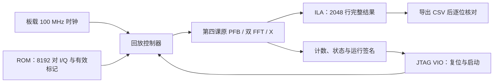

# 第五课 A：片内回放、板级实现与 JTAG 观察

日期：2026-10-28。将第四课的两路 PFB-FX 搬到 FNIC-KU5P，输入暂用合成 ROM，完整结果经 ILA 抓回并与整数参考比较。真实 RFSoC 接入、100G 和持续吞吐属于后续第五课 B。

后续状态：本课两次硬件抓取及原 bit/LTX 均已保留。2026-10-28 的 [05D PCIe 开发](lesson05d-pcie.md) 已把当前 SRAM 替换为独立 PCIe 测试设计，Flash 未修改；本文记录的是本课已完成的历史验收。

## 1. 本课的硬件走向



处理链、回放、VIO 与 ILA 共享同一个系统时钟。VIO 是电脑经 JTAG 访问的慢速控制/状态接口；ILA 是 FPGA 内的采样存储器。VIO 不承担样本输入，ILA 不承担持续观测数据输出。

## 2. 板卡依据和引脚

本机下载目录的厂家资料经过文字与相关页面图像核对：

- `FINC-KU5P_FPGA逻辑使用手册.pdf`：Rev1.0，LED 实验中的时钟、复位及 LED 约束，文件 SHA256 `db947241f1e2965f60fcc708560a9727ce5e98b63a327650e0c936df0e907e05`。
- `FNIC-KU5P_SCH_Rev1.0.pdf`：器件标注 XCKU5P-1FFVB676I，100M_OSC、BANK64 的 SYS_CLK 与 BANK84 LED，SHA256 `a5ffa7e0ed9de002e1375e2c088e008ac4997a2f35d8c4c8188d495822d18b49`。
- `FINC-KU5P_PIN.xdc`：与上述使用引脚交叉核对。仓库只保存自行编写的三个端口约束，未复制整份厂家工程。

| 顶层端口 | 封装引脚 | 电平 | 用途 |
|---|---|---|---|
| SYS_CLK | AB21 | LVCMOS18 | 板载 100 MHz 单端时钟，进入 IBUF/BUFG |
| LED1 | AF14 | LVCMOS33 | 心跳，低有效 |
| LED2 | AF15 | LVCMOS33 | 无错误完成后亮，低有效 |

约束为 [lesson05_fnic_ku5p.xdc](../constr/lesson05_fnic_ku5p.xdc)，目标器件固定 `xcku5p-ffvb676-1-i`。JTAG 实际识别到 xcku5p；完整封装/速度/温度等级依据厂家资料，未通过 JTAG 宣称读取到了完整丝印料号。

LED 是人眼状态输出，没有外部采样时钟，因此只对这两个输出显式设置 false path。计算路径不使用此例外；不使用缺省 I/O 电平或放宽 UCIO/NSTD 检查来生成位流。

## 3. 回放与结果是什么

输入为两路 16 位复数电压，共 16 个 512 点块，逻辑 ROM 容量 8192×64 位，即 64 KiB。两路都是 25.25 频道单音，幅度 20000，B=jA。A 在相对块 4 无效，B 在相对块 6 无效；无效块的原始 ROM 数值保留，用于检查 PFB 确实按质量标记排除数据。

配置固定为 M=4、首帧 1000、epoch=5005、config=0x00050001、来源 A=0/B=8。来源编号仅是本课合成演示标签，不代表已经接入真实 RFSoC。

| 窗口 | 首/末计划帧 | W_A | W_B | W_AB |
|---|---|---:|---:|---:|
| 0 | 1000..1003 | 1 | 1 | 1 |
| 1 | 1004..1007 | 0 | 2 | 0 |
| 2 | 1008..1011 | 4 | 2 | 2 |
| 3 | 1012..1015 | 4 | 4 | 4 |

每个窗口输出 512 行，共 2048 行，每行 650 位，包含全部相关值和第四课元数据。权重、滤波标度及无效区的意义见[第四课](lesson04-pfb-weights.md)。

ROM 采用同步读：FETCH 状态读入一个寄存器，DATA 状态保持 valid 与数据直到 ready。处理链产生反压时不前移地址。上电后等待启动，回放完成后保持 DONE；再次开始必须先复位，避免混用前一轮历史。保留处理错误、元数据计数检查和 100 万个忙碌时钟的超时保护。

32 位 signature 是“循环左移 5 位再异或分组数据”的快速运行诊断，期望值 `930aa3d5`；它不是 CRC，也不能替代完整结果比较。最终验收需要抓取并精确比较每行全部 650 位。

## 4. BASIC 授权下的调试接口

本机 Vivado 2026.1 BASIC 支持一个 ILA、至多五个物理探针，每个探针至多 1024 位，参见 [AMD 授权表](https://www.amd.com/en/products/software/adaptive-socs-and-fpgas/vivado/vivado-buy.html)。本课显式实例化一个五探针 ILA；互相关实部和虚部合并为 128 位，不丢弃数据。最初六探针方案实际触发 Chipscope 16-620，现已修正。

| ILA 端口 | 信号 | 宽度 |
|---|---|---:|
| probe0 | debug_valid | 1 |
| probe1 | debug_meta | 394 |
| probe2 | debug_auto_a | 64 |
| probe3 | debug_auto_b | 64 |
| probe4 | debug_cross：高 64 位为有符号实部，低 64 位为有符号虚部 | 128 |

ILA 深度 2048，输入统一经过一级寄存器。开启存储限定，只保存 debug_valid=1 的周期；窗口间的等待不占缓冲区。需要在回放启动之前 arm，才能保留第一行。

本机实测不能用 `run_hw_ila -trigger_now` 替代本课触发流程：首次这样抓取时包含了 valid=0 的空闲周期，严格检查器拒绝了数据。最终同时把普通触发条件和存储限定设为 debug_valid==1，使用 `run_hw_ila` 后再启动回放，得到完整 2048 行。

debug_meta 的位段为：

| 位段 | 字段 |
|---|---|
| 393:385 / 384 | bin / last |
| 383:352 | window_id |
| 351:320 / 319:288 / 287:256 | W_A / W_B / W_AB |
| 255:224 | M |
| 223:160 / 159:96 | first_frame / last_frame |
| 95:64 / 63:32 | epoch / config |
| 31:16 / 15:0 | source_a / source_b |

VIO 两个输出是 control_reset、control_start；六个输入包括 debug_status、输入计数、结果计数、signature、运行周期和固定设计标识 0x46580501。debug_status 的 bit5 为上电复位已释放，bit4/3 为 core protocol/clip，bit2 为 error，bit1 为 done，bit0 为 busy。正常等待时为 0x20，运行时为 0x21，完成时为 0x22。

## 5. 如何重建

在仓库 PowerShell 中运行：

```powershell
.\scripts\run_lesson05.ps1 -Python 'C:\path\to\python.exe' `
  -VivadoBin 'D:\AMDDesignTools\2026.1\Vivado\bin' -Implement
```

默认目录为 `D:/work/build/KU5P_FX_Accelerator/lesson05_board`。省略 -Implement 只验证回放仿真。所有位流仍由唯一入口 `tcl/build.tcl` 构建；本课函数在 `lesson05_project.tcl`。脚本生成本机 FFT/ILA/VIO，检查源码和数据哈希，拒绝旧 PASS 或旧位流。

MCP 可用 -PrepareOnly 生成参考并冻结输入，再在空的 Vivado Tcl 会话中运行：

```tcl
set argv [list xcku5p-ffvb676-1-i lesson05_board_top {D:/work/build/KU5P_FX_Accelerator/lesson05_board} prepare]
source -notrace {D:/work/KU5P_FX_Accelerator/tcl/build.tcl}
```

随后行为仿真运行到 PASS，调用 `lesson05_accept_simulation`。用 `lesson05_start_implementation` 异步启动长构建，查询 get_runs 的 STATUS；实现与 write_bitstream 完成后调用 `lesson05_collect_implementation`。最后由 `lesson05_manifest.py finish --build-dir <build_dir> --implemented` 生成构建验证记录。CLI 的完整入口使用相同函数并等待结束。

## 6. 如何配置 FPGA 并抓取

JTAG 配置本课位流将替换当前 SRAM 设计，断电后的启动仍由板上既有启动内容决定。本课的硬件脚本执行 SRAM 配置，不包含配置 Flash 操作。

首先运行 `check_lesson05_hardware.py --build-dir <build_dir> --check-build-only`，确认源文件、数据、位流、LTX 和布线时序匹配。随后在同一 Vivado/MCP 会话中运行：

```tcl
source -notrace {D:/work/KU5P_FX_Accelerator/tcl/lesson05_hardware.tcl}
lesson05_program {D:/work/build/KU5P_FX_Accelerator/lesson05_board}
lesson05_capture {D:/work/build/KU5P_FX_Accelerator/lesson05_board} run1
lesson05_capture {D:/work/build/KU5P_FX_Accelerator/lesson05_board} run2
```

脚本要求只有一个本地 Digilent 目标、一个 xcku5p。每次抓取先复位并核对计数归零，再 arm ILA、释放复位并启动。原始 CSV、可在 Vivado 中打开的 .ila 和 VIO 状态保存在 hardware/，设备序列号不写进公开文档。

然后运行严格比较：

```powershell
python -B scripts/check_lesson05_hardware.py --build-dir D:/work/build/KU5P_FX_Accelerator/lesson05_board --label run1 --label run2
```

必须收到 2048 个有效样本，顺序及全部位精确匹配；不跳过错误行、不以签名代替逐位核对。检查器同时验证复位前后计数、完成状态、签名、运行周期和位流/LTX 哈希，生成 hardware_verification.json 及便于阅读的逐字段 CSV。

在 GUI 中可打开 vivado_project/lesson05_board.xpr，进入 Hardware Manager 连接目标，选择配对的 .bit/.ltx。最容易复现的方法是在 Tcl Console 调用上面两个函数，先让脚本完成配置和采集，再在 ILA Dashboard 看波形、在 VIO 中看 control_reset/control_start、计数及状态。

如需手动实验：将 reset=1/start=0 提交，设置 ILA 深度 2048、触发位置 0、普通触发 debug_valid==1、Capture Control 同样 debug_valid==1；先 arm，然后在同一次 VIO 提交中释放 reset 并置 start=1。结果完成后再导出 CSV。LED1 应显示心跳，成功完成后 LED2 应亮；本次没有目视检查实物亮灯。

## 7. 本机实际验收

2026-10-28 已通过当前聊天的原生 Vivado MCP 完成仿真、实现、JTAG SRAM 配置及两次独立抓取。

| 检查 | 结果 |
|---|---|
| 回放 RTL 仿真 | 8192 对输入、2048 行完整结果精确匹配，含部分回放复位与 start 保持测试 |
| 两次 FPGA 抓取 | 每次 2048 行，每行全部 650 位与整数参考相同，两份原始 CSV 的 SHA256 相同 |
| 复位/结束 | 每轮先读到输入/输出计数均为 0，结束为 8192/2048，debug_status=0x22 |
| 运行签名 | 两轮均为 0x930aa3d5 |
| 周期数 | 两轮均为 86147，与本次仿真一致；按 100 MHz 名义时钟约 0.86147 ms |
| 最终落盘时序报告 | WNS=+3.339 ns、WHS=+0.014 ns，TNS/THS=0 |
| 时钟与端点 | no_clock=0，未约束内部端点=0，未设置输入延迟=0；两个 LED 输出有明确的 false path |
| 物理布线 | 24337 条可布线网络全部完成，路由错误 0，无未解析黑盒 |
| DRC | Error=0；仍有 DSP 流水线、厂商 IP RAM 等优化/使用告警，不能称为全部 DRC 零告警 |
| CDC 与总线偏斜 | 调试 hub 的 TCK↔sys_clk 共 15 个端点判为 Safe，Unsafe/Unknown 均为 0；4 条 bus-skew 约束满足，最小余量 9.496 ns |
| 抓取解析器 | 4 项测试通过：宽总线/负数位型、未知位、无效周期、探针宽度溢出 |

最终资源包括数据链、ROM、VIO、ILA 和 debug hub：

| 资源 | 数量 |
|---|---:|
| LUT | 9526 |
| 触发器 | 16977 |
| DSP48E2 | 56 |
| RAMB36E2 / RAMB18E2 | 56 / 13 |
| BRAM36 等效块 | 62.5 |
| URAM | 0 |
| 物理 I/O | 3 |

ILA 占 36 个 RAMB36 和 1 个 RAMB18。调试存储也是硬件资源，不能把包含大抓取缓存的本课资源直接当作未来十六通道业务链资源。

位流为 `lesson05_board_top.bit`，SHA256 `96854f46a7b45483534dd6f908a324a129b721421d680ef7e03b1609727dcd49`；配对 LTX 的 SHA256 为 `6d0e350f0687286591b7838cfc915f3fa3e2bbecdd8e2133f60d5e1725c2ba80`。它们与 routed DCP、报告、原始抓取、解码 CSV、运行状态及验证 JSON 均位于仓库外构建目录。

bus-skew 报告由标准实现 run 自动生成，位于 `vivado_project/lesson05_board.runs/impl_1/lesson05_board_top_bus_skew_routed.rpt`。实际 MCP 操作摘要为构建目录的 `mcp_execution.json`。图 `lesson05_hardware_results.png` 直接绘制通过全部位比较的真实 ILA CSV；它与第四课的模型图有不同的数据来源。

可用 `plot_lesson05_hardware.py --build-dir <build_dir>` 复现硬件结果图，需要 Matplotlib。绘图前会核对源码、位流和原始抓取哈希。

## 8. 验证边界与下一步

构建记录 verification.json 描述仿真与布线后的设计；hardware_verification.json 描述真实 FPGA 的抓取验收。二者分别保存，不以“生成了位流”替代“实际运行通过”。

本课仍是一帧在途的可暂停数据链。8192 对样本在仿真中用了 86147 个处理时钟，输入等待 32708 拍；即使系统时钟为 100 MHz，也不等于持续处理 100 MS/s。用户暂不便连接 RFSoC，后续先用离线候选报文、PC/ConnectX-5 和片内合成源推进网络/缓存/连续处理准备，再扩展十六通道；真实短记录就绪后接入同一验证入口，见[接入前准备](rfsoc-preparation.md)。

RFSoC 的原始工程、BD/XSA/位流和抽取证据继续保留在仓库外。当前 ROM、RTL、模型与文档均为自行生成或编写，厂家 IP 从本机工具重新生成。
