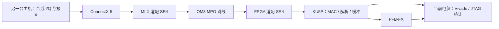

# RFSoC 接入前的准备路线

更新：2026-10-28。用户目前有 RFSoC，但暂时不便连接，可能需要重新配置。开发继续围绕近期 FX 目标，先利用 KU5P、PC 和合成数据完成可独立验证的环节。

## 1. 已有条件与待核对项

| 项目 | 当前事实 | 状态 |
|---|---|---|
| KU5P | 两路 PFB-FX 的 ROM 回放已完成两次完整硬件验收 | 已验证，见[第五课 A](lesson05-board-replay.md) |
| 主机 | CIM 读回 ASUSTeK PRIME Z790-P Rev1.xx，Windows 10 | 已读回 |
| 网卡 | 用户有 ConnectX-5；散热板与当前主板接头干涉，无法在当前主机同时安装 | 改用另一台测试主机；标签无完整型号，安装后从 PCI 设备 ID/型号与只读查询识别 EN/VPI/Ex、端口能力 |
| 两个光模块 | 用户说明均为万兆通 100G-SR4 多模，分别标称适配 MLX 和 FPGA | 具体 P/N、EEPROM 信息及两端实测待核对 |
| 光纤 | 同品牌，OM3-MPO-MPO、8 芯、3 米；标签无 Type-B/B 型标记 | 极性未知，不能按 B 型使用；纤序、键位和公母待核对 |
| RFSoC | 现有 100/320 MS/s 工程已静态核对；实际设备可能需重新配置 | 暂不依赖在线设备推进 |
| KU5P 100G 工程 | 厂家手册提及 Corundum 移植和 SI5338 配置 | 尚未确认获得本板完整、可复建的 100G 源工程 |

“MLX 适配”“FPGA 适配”是两端主机兼容信息，不能用来独立判断光学链路是否匹配。应分别核对两只模块的速率/光学标准、波长/纤型、纤位、端口允许的模块类型及 FEC。100G-SR4、多模 OM3 与 MPO 是相应的候选组合，尚未据此宣布现有两只模块互通。

模块直接互联通常使用 Type-B 交叉 MPO 跳线，见 [HPE 的 SR4 纤位说明](https://arubanetworking.hpe.com/techdocs/Switches/xcvrs/xcvr_guide/Content/GUID-A57608BB-F36E-4045-9753-2CDBCD19FF91.html)。8 根工作纤不能代替极性检查；本条不假定用户现有跳线已经是 B 型。

标签缺失时，可向供货商按订单核对纤序图，或由有工具的人员做端到端纤序测量；无标记不等于已证明为 A 型或不兼容。网卡完整型号也不再要求从缺失的标签获得，后续在另一台主机枚举后识别。当前主机保留 KU5P 与 Vivado/JTAG 开发环境，另一台主机负责 ConnectX-5 发包，两者通过光纤连接即可。

## 2. 主机 PCIe 是提前发现的限制

[ASUS 本板规格](https://www.asus.com/motherboards-components/motherboards/prime/prime-z790-p/techspec/)列出：一个 CPU 侧 PCIe 5.0×16 插槽，以及三个形状为 ×16、实际最多工作在 PCIe 4.0×4 的芯片组插槽。具体卡实际协商的代数/宽度还需安装后读回，不能由插槽长度推断。

ConnectX-5 与 ConnectX-5 Ex、EN 与 VPI 的能力随完整型号变化，参见 [NVIDIA 产品手册](https://networking-docs.nvidia.com/connectx5enhw/introduction)。普通 Gen3 卡插在 Gen4 槽里仍受卡本身代数限制；若为 VPI，还要确认实际端口工作在 Ethernet 模式。

以下为只扣 128b/130b 编码的单向理论上限，未扣 PCIe 事务开销和其他主机开销：

| 实际协商 | 上限 |
|---|---:|
| PCIe 3.0×4 | 约 31.51 Gb/s |
| PCIe 4.0×4 | 约 63.02 Gb/s |

即使机械安装允许，下方插槽也不能预先承担“主机持续向网卡提供满 100 Gb/s 数据”的验收。用户现在已确认机械干涉，因此不再安排在当前主机安装 ConnectX-5。以上数字仅保留为已核对的平台限制，不能套用到尚未选定的另一台主机。两台 100 MS/s、共十六路 I/Q16 的净样本负荷是 51.2 Gb/s，更超过 Gen3×4 的理论上限。网络端口训练为 100GbE 与主机 DMA/软件发包速率是两个分别测量的量。

先在现有电脑完成不依赖网卡的开发。另一台主机就绪后，核对其物理空间、插槽实际代数/宽度、驱动与实际协商速率；先做低负荷已知数据测试，再评估能否产生持续高负荷流。暂不据此安排购买或改造。

## 3. 近期按什么顺序推进

| 阶段 | 工作 | 不连接 RFSoC 时的验收 |
|---|---|---|
| 05B-1：已开始 | 候选报文生成/解析、已知 I/Q 字节、双源编号、重复/乱序/缺口/坏包 | 离线 PCAP 和独立字节断言可复现；明确哪些结论仍待真实抓包 |
| 05C：当前下一项 | 可配置片内测试源、FIFO/整帧缺失标记、PFB/FFT/X 的连续处理改造 | 产生、接收、丢弃分开计数；在声明速率下长期运行，窗口 W 与参考一致 |
| 05D：前移的主机读出 | PCIe 枚举/BAR、已知片内数据 DMA、FX 结果主机读回；与单口 100G 准备并行 | 实际 PCIe 链路读回，内容与计数一致，阻塞/溢出可见，独立测 DMA 净带宽 |
| 05B-2：准备条件后联调 | 在另一台主机安装并识别 MLX；核对模块/纤位；建立 PC↔KU5P 单口 100G 工程 | 读回实际 PCIe 链路、模块身份和端口模式；证明 PCS/FEC/MAC 状态正常 |
| 05B-3 | PC 作为可控采样源，先低负荷向 KU5P 发包 | 每源/通道/序号可追踪，长度、字节序、缺口和有效样本数与主机预期一致 |
| 06：可先用合成源 | 扩展十六路 X，覆盖十六项自相关与一百二十项互相关 | 136 项结果、来源映射和已知幅相模型一致，重新验收资源与吞吐 |
| RFSoC 可连接后 | 核对/恢复固件、真实短记录、共同起点与相位、接入已验收链路 | 补充 ADC/抽取通带、真实字节顺序、连续性和跨板相干证据 |

首个外部测试连接为：



该连接可分别验证光链路、包协议和算法，暂不依赖 KU5P PCIe DMA；MLX 侧仍需要正常的主机 PCIe 与驱动。当前图表示实施目标，还没有安装网卡或构建/测试本板 100G MAC。

实际开发顺序为 **05B-1 离线协议 → 05C 片内连续流 → 外部单口链路 → 十六路 FX**。阶段编号保留原来的工作包含义，不要求等待另一台主机才能开始 05C。与 05C 同期可整理 MAC 后端无关的接收接口、板卡时钟与约束、100G IP 和授权条件。

2026-10-28 后续补充：处理核心首轮优化已完成；用户进一步询问主机读出，因此将 **05D PCIe/主机闭环前移到十六路扩展之前**。现已完成独立 XDMA 测试端点的应用仿真、板级布线和 SRAM 配置；当前 link_up=0、Windows 未枚举，管理员重扫描与匹配 Windows 驱动仍待解决，真实 BAR/DMA 尚未通过。单口 100G 同期准备；两端分别通过后，再接通网络输入、FX 和 PCIe 结果输出。不能把算法吞吐或用户态模拟测试当作网络/DMA 可用，详见[PCIe 阶段记录](lesson05d-pcie.md)。

本板资料显示 PCIe Gen3×8 布线。即使实际成功协商到该规格，其单向理论编码后上限也只有约 63.0 Gb/s，不能承诺将持续 100G 原始输入全部直送主机；FX 积分结果与短记录分别预算。两个 QSFP28 与一个 100G 硬核的区别、第二套接收通路的条件和主机读出限制见[板卡信息](hardware.md)。

05D 最新诊断：管理员重扫已经成功执行，Windows 仍未枚举。已配置 d2 固件确认参考时钟有活动且 GT 电源就绪，但 AXI 时钟无活动、链路未建立；下一步验证保持供电的主机重启，见[诊断记录](lesson05d-pcie-diagnosis.md)。

厂商手册提到的 IBERT 眼图例程不能代替 Ethernet 接收验收，本机 BASIC 授权也未覆盖 IBERT。单口 100G 工程需包含可复建的顶层/约束、GT 与参考时钟、SI5338 配置、MAC/PCS/FEC 和模块控制。仅有上游 Corundum 仓库不能自动替代该板移植。

[AMD PG203 的授权说明](https://docs.amd.com/r/en-US/pg203-cmac-usplus/Licensing-and-Ordering)将 `cmac_usplus` 列为可免费获得许可的 IP；集成 RS-FEC 与 SR4 不需要 CR4/KR4 的付费 AN/LT。BASIC 能生成第五课位流，不自动证明 CMAC 的构建授权已就绪。本机 2026.1 目录查询已发现 `cmac_usplus:3.1`，目标料号列于其支持列表；目录存在不等于本板 100G 工程、授权或时序验收已经通过。

可在没有打开其他工程的 Vivado Tcl Console 中复现只查目录的检查：

```tcl
source D:/work/KU5P_FX_Accelerator/tcl/check_100g_catalog.tcl
check_100g_catalog D:/work/build/KU5P_FX_Accelerator/rfsoc_preflight
```

输出 `cmac_catalog.tsv`，不生成 CMAC、不打开硬件、不申请或安装许可证；授权检出与板级网络状态单独列为未验证。

## 4. 为什么连续吞吐要单独做

第五课 A 的 8192 对样本用了 86147 拍，以名义 100 MHz 折算约 9.51 M 对/秒，即两路同时各约 9.51 MS/s。这是已测短回放的平均值，不是持续吞吐极限或 100 MS/s 验收。

目前 ROM 会服从 ready 等待，PFB 四个抽头分拍计算，一帧完成后才接下一帧。AXI-Stream 的成功传输发生在 valid/ready 同时有效的周期，等待期间数据须保持，参见 [AMD 握手规则](https://docs.amd.com/r/en-US/ug1483-model-composer-sys-gen-user-guide/AXI4-Stream-Support-in-Model-Composer)。真实采样源的时间轴不能因为下游等待而停住。

下一步测试平台应把“独立采样节奏的数据产生器”和“服从握手的流接口”隔开：前者持续推进样本/帧号，缓存负责吸收突发；存不下时显式记缺失并按原计划生成无效帧。不能通过改号掩盖丢样，也不能让 AXI 源在 valid=1/ready=0 时任意更换数据。

FIFO 可缓冲突发，不能修复长期平均输入大于处理能力的问题。将逐步流水化/并行化 PFB 与 X，允许 FFT 帧间连续，并让积分结果读出与下一窗口处理解耦。先验证两路，再扩展十六路；100G 线速、用户总线带宽和样本处理率分别测量。

05C 的第一轮 RTL 验收固定为两路、512 样本/块，复用第五课算术参考，先把数据源与接收握手分开：

用户随后要求先优先优化处理流水线，因此本节数据源/缓存项目在核心优化之后实施。新的核心及验证结果单独记录在[第五课 C 优化要点](lesson05c-pipeline-notes.md)，不能继续用旧回放的 9.51 MS/s 代表新核心；新核心的仿真折算速率也不能替代真实网络与上板测速。

1. 独立节拍产生完整样本块，块编号不因下游等待而停止；速率可配置，既测低于当前处理能力的输入，也主动制造超载。
2. 按整块预留缓存，空间不足则记整块缺失，不能交付半块后静默丢弃另一半。算法入口为缺失编号提供无效占位块，保留原计划积分窗口。
3. 输入缓存溢出、有效块交付、无效占位和结果输出分别计数；输入停止且缓存排空后，真实产生样本数应等于真实交付数加丢弃数，占位零值不计成真实样本。
4. 自检查仿真核对停顿期间接口稳定、无覆盖/重复、计划编号与三种 W；通过后再在 KU5P 用 ILA 核对统计。第一轮目标是揭示并正确处理速率不足，连续 100 MS/s 作为后续算术改造的独立验收。

## 5. 本次已完成的离线工具

自行编写：

- [rfsoc_packet_candidate.py](../scripts/rfsoc_packet_candidate.py)：候选 Ethernet/IPv4/UDP 和 32 字节元数据模型、I/Q 解码、每源/通道序号跟踪、经典 PCAP 读写。
- [prepare_rfsoc_fixtures.py](../scripts/prepare_rfsoc_fixtures.py)：生成正常十六流、序号故障和元数据错误三份合成 PCAP。
- [inspect_rfsoc_pcap.py](../scripts/inspect_rfsoc_pcap.py)：输出接受数、拒绝原因、序号事件和源身份报告。
- [test_rfsoc_packet_candidate.py](../tests/test_rfsoc_packet_candidate.py)：9 项测试，含独立十六进制字节断言和已知 IPv4 校验和。

候选元数据以小端解释：偏移 0/4/8/12 为 head marker、format tag、port_id、data_type（各 32 位），偏移 16 为 64 位包计数，偏移 24 为 64 位 tail marker。随后假设为 2048 对有符号 16 位 I/Q，小端交错。字段值来自原工程的静态定义，I/Q 实际线序仍需已知模式抓包证实。

候选 UDP 用户数据为 8224 字节，IPv4 总长 8252 字节。测试帧含 54 字节非零尾部填充，总长 8320 字节、不含 Ethernet FCS；解析器依据 IP/UDP 长度截取，填充不会变成采样。支持 IPv4 无校验和 UDP 的合法形式；非零 UDP 校验和会验证。这里没有验证 Ethernet FCS，真实接收需使用 MAC 的坏帧/CRC 状态。

后续外部发包需要容纳至少 8252 字节的 IP MTU，通常采用两端匹配的 9000 字节设置，并核对 MAC 的最大帧长；当前解析器不接受 IPv4 分片。标准 UDP socket 发包不会自动产生这里专门构造的 54 字节 Ethernet 尾部，它只是边界测试输入；实际尾部行为以真实抓包和 MAC 接口为准。现在没有修改任何网口 MTU。

不支持项会明确拒绝：IPv4 分片/选项、VLAN、PCAPNG 或截断快照。不把这些限制描述成原 RFSoC 一定没有这些行为；首版只固定当前候选范围，后续按实际需要扩展。

跟踪键包括源 MAC、源 IP、UDP 源端口和板内通道，不把两板的同一个 port_id 混合。第一次见到某流时只建立本次观察起点，不推断开始之前的丢包。

对计数 `0,2,1,2,3`，当前保守交付策略报告 `first,gap,late,duplicate,in_order`；迟到包被标记并丢弃，不执行重排恢复。因此“missing_at_delivery_slots=1”表示交付时出现一个缺口，不能把它改称为已证明的物理丢包。采集重启必须显式开始新会话；包计数本身不提供 UTC 或跨板共同采样时刻。

所有报告均带 `rf_hardware_validated=false`。生成器/解析器互相通过不证明与现场 RFSoC 兼容；独立字节测试证明的是当前候选协议实现的内部正确性。

## 6. 复现与实际结果

使用普通 Python 标准库，无需联网、管理员权限或额外数据包库：

```powershell
python -B -m unittest discover -s tests -p test_rfsoc_packet_candidate.py -v
python -B scripts/prepare_rfsoc_fixtures.py --output-dir D:/work/build/KU5P_FX_Accelerator/rfsoc_preflight
python -B scripts/inspect_rfsoc_pcap.py D:/work/build/KU5P_FX_Accelerator/rfsoc_preflight/normal_16_flows.pcap --report D:/work/build/KU5P_FX_Accelerator/rfsoc_preflight/normal_report.json
```

实际通过 9 项测试。正常场景 32 包、16 条独立流、65536 个复数样本；序号故障场景接受 3 包/6144 样本，分别识别一个缺口、一个迟到包、一个重复包；元数据损坏场景拒绝该包。

合成 PCAP、报告与源文件哈希清单在仓库外的 `rfsoc_preflight/`。本次没有安装网卡/驱动、改变网卡固件或 RFSoC 配置、向网络发包，也没有把 RFSoC 工程复制进仓库。

## 7. RFSoC 真正接入前的退出证据

1. 在可安装 ConnectX-5 的另一台主机识别网卡具体能力、实际 PCIe 代数/宽度与 Ethernet 模式；缺少标签时使用 PCI 设备信息和只读型号查询。记录两端模块 EEPROM/光功率和实际纤序。
2. KU5P 单口 100G 工程可从源码重建，GT/时钟、PCS/FEC、坏帧和有效包计数有记录。
3. PC 的可控样本包到 KU5P 后，源、通道、序号、长度及样本内容与预期一致，故障包有明确处置。
4. 声明速率下产生/接收/丢弃守恒，缓存溢出不静默，计划窗口与 W 在丢样下仍正确。
5. 之后再用已知模式 RFSoC 记录冻结真实线序，验证模拟/抽取通带、起点、重启和跨板相干。

这些是分阶段验收目标，当前只有第五课 A 硬件与本页的离线候选协议测试已经通过。
